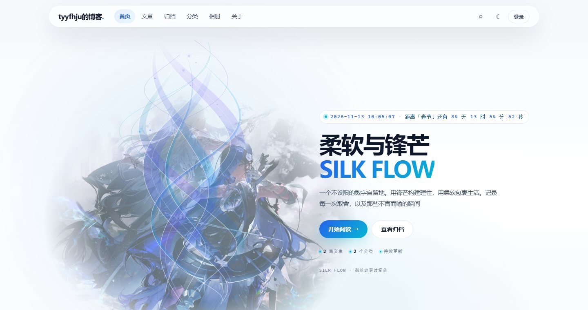
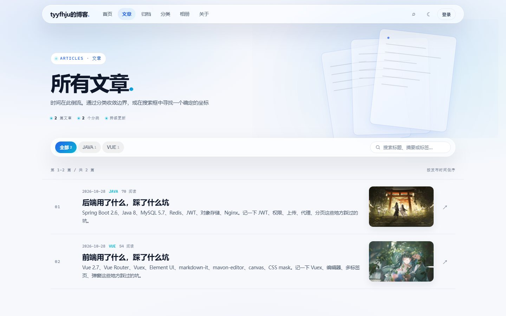
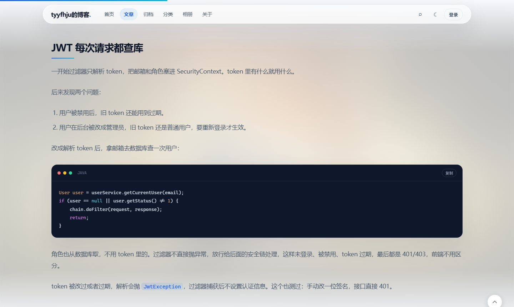
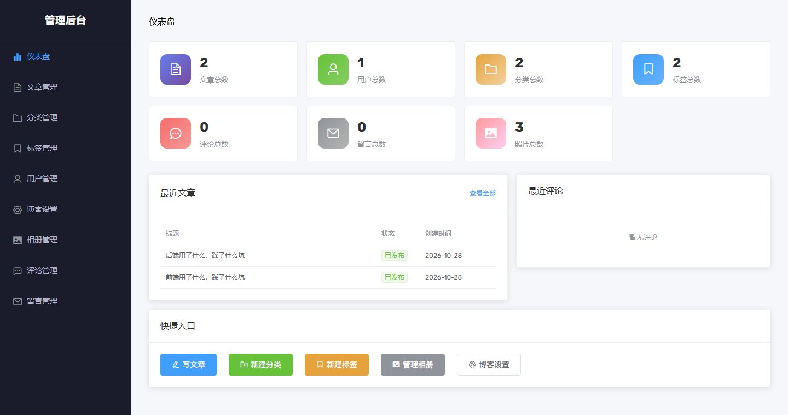
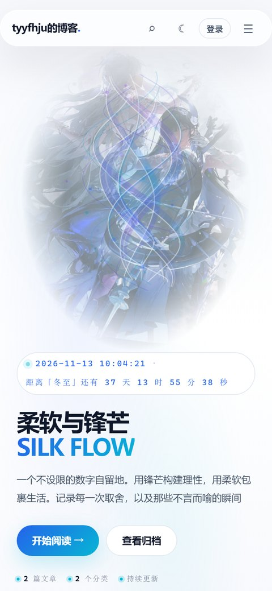
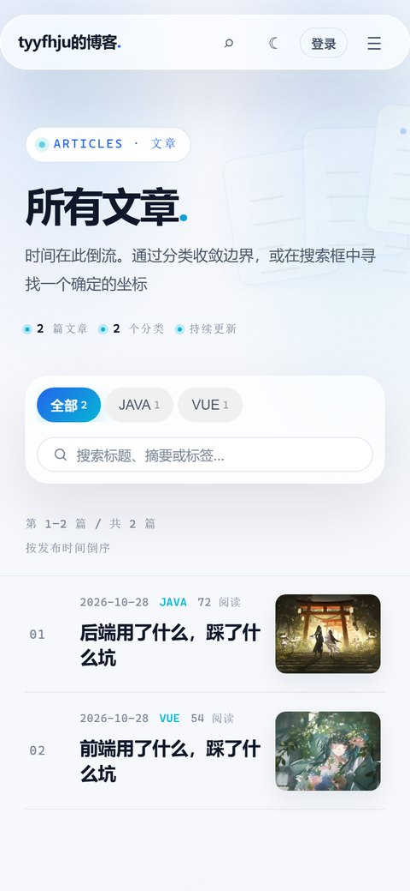

# 个人博客 · 前端

这是我博客的前端，前台和后台都在这个仓库里。

线上地址：<https://xn--hlry9isyc4tas57t.com>

后端在另一个仓库：[tyyfhju/blog-backend](https://github.com/tyyfhju/blog-backend)

后端架构和完整部署看这里：[blog-backend / README.md](https://github.com/tyyfhju/blog-backend/blob/main/README.md)

## 页面预览

<p align="center">
  <a href="https://xn--hlry9isyc4tas57t.com/">
    
  </a>
  <br>
  <sub>首页：流丝动画、深浅主题、首屏排版</sub>
</p>

| 文章列表 | 文章正文 |
| --- | --- |
| [](https://xn--hlry9isyc4tas57t.com/articles) | [](https://xn--hlry9isyc4tas57t.com/article/17) |
| 分类、搜索、缩略图、时间索引 | Markdown 正文、代码高亮和复制按钮 |

<p align="center">
  
  <br>
  <sub>后台：仪表盘、文章管理、分类标签、相册和站点设置</sub>
</p>

### 手机端

<p align="center">
  <a href="https://xn--hlry9isyc4tas57t.com/">
    
  </a>
  &nbsp;&nbsp;&nbsp;
  <a href="https://xn--hlry9isyc4tas57t.com/articles">
    
  </a>
</p>

截图来自线上站点，桌面端宽度 1440px，手机端 390×844。

## 页面有什么

- 首页、文章列表、文章详情、归档、分类、相册、关于
- 搜索、点赞、上下篇、相关推荐
- 评论和关于页留言，登录后才能发，作者显示登录邮箱
- 登录、注册、邮箱验证码、找回密码
- 个人中心可以改资料和头像
- 深浅主题，手机端也做了适配
- 后台：文章、分类、标签、用户、评论、留言、相册、站点设置

## 用的什么

Vue 2.6 + Vue Router 3 + Vuex 3。

后台用了 Element UI，文章用 markdown-it 渲染，后台的 Markdown 编辑器是 mavon-editor，代码高亮用 highlight.js。首页和文章页的动画是 canvas 2D 自己画的。

## 目录

```text
frontend/
├── public/
│   └── index.html
├── src/
│   ├── api/              接口封装
│   ├── assets/           全站样式
│   ├── components/       公共组件
│   ├── content/          前台文案默认值
│   ├── router/           路由和登录/管理员守卫
│   ├── store/            Vuex
│   ├── utils/            工具函数
│   ├── views/            前台页面
│   │   └── admin/        后台页面
│   ├── App.vue
│   └── main.js
├── vue.config.js         开发端口和 /api 代理
└── package.json
```

## 本地怎么跑

先保证后端在 `http://localhost:8080` 跑着，然后：

```bash
npm install
npm run serve
```

打开 `http://localhost:8081`。

`/api` 会在 `vue.config.js` 里代理到 8080，本地不用改接口地址。

打包：

```bash
npm run build
```

产物在 `dist/`。

## 怎么部署

前端就是一堆静态文件，传到 `/var/www/blog/dist`，Nginx 指过去，`/api/` 转给后端。

线上前面还挂了腾讯 EdgeOne，源站 Nginx 也开了 HTTPS，所以是 EdgeOne 证书和源站证书两套。前端这边不用管，证书续期和 EdgeOne 同步看后端 README 里的「EdgeOne 和证书续期」。

### 1. 上传

把本地 `dist` 里面的内容传到：

```text
/var/www/blog/dist/
```

最终结构：

```text
/var/www/blog/dist/
├── index.html
├── js/
├── css/
├── fonts/
├── img/
└── favicon.ico
```

别传成 `/var/www/blog/dist/dist/index.html`。

### 2. 权限

```bash
sudo chown -R www-data:www-data /var/www/blog
sudo find /var/www/blog -type d -exec chmod 755 {} \;
sudo find /var/www/blog -type f -exec chmod 644 {} \;
```

### 3. Nginx

```nginx
server {
    listen 80;
    listen [::]:80;
    server_name <域名> www.<域名>;

    root /var/www/blog/dist;
    index index.html;
    client_max_body_size 50m;

    location ^~ /api/ {
        proxy_pass http://127.0.0.1:8080;
        proxy_set_header Host $host;
        proxy_set_header X-Real-IP $remote_addr;
        proxy_set_header X-Forwarded-For $proxy_add_x_forwarded_for;
        proxy_set_header X-Forwarded-Proto $scheme;
    }

    location = /sitemap.xml {
        proxy_pass http://127.0.0.1:8080;
        proxy_set_header Host $host;
    }

    location / {
        try_files $uri $uri/ /index.html;
    }
}
```

```bash
sudo nginx -t
sudo systemctl reload nginx
```

### 4. HTTPS

```bash
sudo certbot --nginx -d <域名> -d www.<域名> \
  --redirect --agree-tos -m <邮箱> --no-eff-email
```

## 更新

```bash
npm run build
```

把新的 `dist` 内容覆盖到 `/var/www/blog/dist`，再改一下权限就行。静态文件换完一般不用重启 Nginx。

## 几个注意的

- 传的是 `dist` 里面的内容，不是 `dist` 文件夹本身。
- 后端地址不要写死在代码里，统一走 `/api`。
- 登录 token 存在 localStorage，换浏览器要重新登录。
- Vue 2 打包体积会报警告，正常的。
- 只换前端时后端不用动；只换后端时前端静态文件也不用动。

## 说明

这个仓库主要是给自己博客用的，目前没有 LICENSE 文件。
